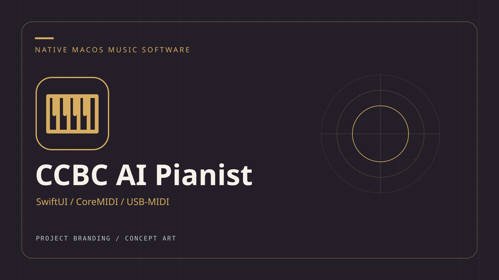

# Cave City Baptist Church — AI Pianist



Native **macOS SwiftUI** application for the **MacBook Neo (Apple A18 Pro)** and a **Korg KRONOS** using USB-MIDI. Developed separately from LXRION, OWI, and the church website.

## Open in Xcode
1. On your Mac, open Terminal and run:
   ```bash
   git clone https://github.com/LeeRoberts-FA/CCBC-pianist.git
   open CCBC-pianist/CCBCPianist.xcodeproj
   ```
2. In Xcode select the **CCBCPianist** scheme and **My Mac** destination.
3. Click **Run (▶)**. The native application launches without Python, PySide6, or a browser.
4. If Xcode requests signing for local use, choose your Personal Team in **Signing & Capabilities**.

## What is implemented
- Native SwiftUI window, keyboard audio output with Apple AVAudioUnitSampler, CoreMIDI destination discovery.
- Original four-note C–E–G–C test (no copyrighted music included).
- Standard MIDI File (SMF) **format 0/1** parsing: tempo maps, running status, multiple tracks, note on/off, sustain pedal (CC64). Malformed/unsupported files fail safely.
- Explicit **user review + approval** required to play imported arrangements; stored hymn records in Application Support.
- Background deterministic performance schedule with pause, resume, stop and all-notes-off.
- Optional local Ollama assistant: reads model list and answers hymn-preparation questions **only**. It cannot send MIDI messages.
- No automatic sheet-music transcription or verse generation. No copyrighted hymnal content bundled.

## First run / audio
Mac piano output requires a compatible licensed **.sf2 or .dls sound bank**. The app attempts Apple's General MIDI DLS sound bank where installed and indicates whether loaded. If not available, choose **Load Piano Sound Bank**. Without a sampled instrument, use connected KRONOS MIDI output after confirming correct cabling.

## KRONOS
Use a **USB-C-to-USB-B data cable**, from MacBook Neo to the **square USB-B** port on the KRONOS—not its rectangular host USB-A port. Choose a grand piano Program, MIDI channel 1, and a very low monitor/PA level. In the app: **Refresh MIDI**, select KRONOS, and use the four-note test. The software does not modify the KRONOS operating system.

## Test and safety boundaries
The interface and source can be inspected here; **a Mac/Xcode build and physical KRONOS behavior must be tested locally**. Do not use in worship until all note, timing, PA, emergency-stop, and chord sustain behavior are verified. If the computer freezes or MIDI stop fails, mute the KRONOS at the instrument or church soundboard.

The 2008 LifeWay Worship Baptist Hymnal is the library numbering reference, **not** a license to distribute its copyrighted arrangements. Import only authorized MIDI files and approve them after comparison with the printed score.

## Development
- Xcode project: `CCBCPianist.xcodeproj`
- Source: `CCBCPianist/`
- CI: `.github/workflows/macos-build.yml`
- `scripts/verify.sh` invokes `xcodebuild` on macOS.
